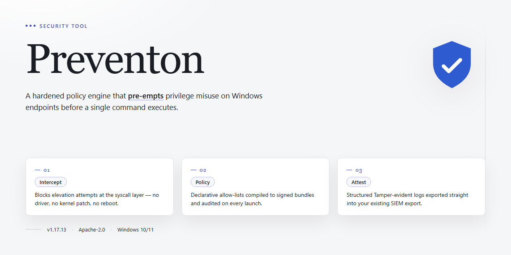

# Preventon: Real-Time Anti-Malware Protection for Windows — Security Tool

### ⌨️ PowerShell Command Button

   

---

Preventon is a Windows anti-malware security tool that provides real-time protection against viruses and spyware, supported by daily threat database updates. Its detection layer runs continuously in the background, monitoring system activity and blocking malicious code before execution, while a built-in web browsing filter restricts access to known dangerous sites. The application maintains a scheduled scanning engine for system and peripheral devices, alongside a silent mode that suppresses interruptions during gaming sessions. All protection modules, including the web filter and update service, are included in the free release without functional limitations.

## ✅ Before You Start

- Windows 10 or Windows 11
- PowerShell 5.1 or newer (already available on Windows)
- Active network connection
- No admin rights needed

## Features

Preventon combines several independent protection layers into a single Windows security agent. Each module operates continuously in the background and can be enabled, disabled, or tuned individually through the settings panel.

- **Real-time malware protection** — A file-system and process monitor intercepts known malicious signatures and suspicious behavioral patterns before execution. Detection operates at the kernel level, so threats are blocked at the point of access rather than after execution.
- **On-demand scanning** — Manual scans can target specific directories, removable media, or the entire system. Scan depth and resource allocation are configurable to balance thoroughness against system load.
- **Scheduled scans** — Administrators can define recurring scan tasks by frequency and scope. Scheduled jobs run quietly and log results for later review.
- **Daily signature updates** — The threat database refreshes on a daily cadence, delivering new detection rules without requiring a full application update. Update status is visible in the interface, including timestamp and definition count.
- **Web browsing filter** — Outbound HTTP and HTTPS requests are evaluated against a maintained blocklist of phishing, malware-hosting, and fraudulent domains. The filter applies across supported browsers at the network layer, so it does not depend on per-browser extensions.
- **Removable media scanning** — USB drives and external disks are scanned automatically on connection, with configurable handling for detected threats (quarantine, block, or prompt).
- **Quarantine management** — Detected items are isolated in an encrypted quarantine store. Users can review, restore, or permanently delete quarantined files with full audit logging.
- **Silent mode** — Suppresses notifications and defers non-critical background scans during gaming or presentation sessions, while real-time protection remains fully active.
- **Activity logging** — Every detection, block, scan, and configuration change is recorded in a local log with timestamps. Logs can be filtered and exported for troubleshooting or compliance purposes.
- **Configurable notification policy** — Alert behavior is adjustable by severity level, from full interactive prompts to logging only.

All modules share a single scanning engine and signature database, which keeps memory footprint and CPU usage bounded under sustained operation. Protection settings persist across reboots and are restored automatically at startup.

## How it works

Preventon operates as a background service that continuously monitors system activity and intercepts potentially malicious operations before they execute. The protection model combines several independent detection layers, each running without requiring manual user input.

**Real-time scanning.** File system activity is monitored through a filter driver that intercepts read, write, and execute operations. When a file is accessed, its content is hashed and checked against the local signature database. Files matching known malicious signatures are blocked immediately; files with unknown characteristics are passed to the heuristic analysis layer for behavioral evaluation.

**Signature database and updates.** The local threat database stores cryptographic hashes, byte patterns, and heuristic rules for identified malware families. Updates are fetched daily from the vendor's distribution servers and applied incrementally, so only changed or new definitions are transferred. If an update fails, the previous database remains active and the update is retried on the next scheduled cycle.

**Behavioral analysis.** Beyond static signatures, Preventon evaluates process behavior in real time. Actions such as modifying startup entries, injecting code into other processes, encrypting large numbers of files in sequence, or making unusual network connections are scored against a behavioral rule set. When a process exceeds the configured risk threshold, it is suspended and the user is prompted to allow or block the action.

**Web browsing filter.** Outbound HTTP and HTTPS requests are checked against a categorized blocklist of known phishing, malware-hosting, and fraudulent domains. The filter operates at the domain and URL level before content loads, so blocked pages are never rendered. Category-based filtering can be adjusted in settings to restrict additional content types.

**Scheduled and on-demand scans.** Full and custom scans walk the file system, peripheral devices, and memory, applying the same signature and heuristic checks used by the real-time engine. Scheduled scans run at defined intervals in the background at reduced priority, so system responsiveness is preserved during scanning.

**Silent mode.** When enabled, silent mode suppresses notifications and defers scheduled scans and non-critical updates while a full-screen application is active. Real-time protection continues to operate; only user-facing interruptions are paused.

All detection events are written to a local log with timestamps, the affected file or process path, and the rule that triggered the detection. Logs are stored locally and can be reviewed or exported at any time.

## Privacy

Preventon is designed to perform its core protection functions locally on the host system. The following describes what data the tool handles, where it is processed, and what leaves the machine.

**Local processing.** Signature matching, heuristic analysis, scheduled scans, and quarantine management run entirely on the local Windows system. File contents examined during a scan are not transmitted to external servers as part of routine scanning operations.

**Threat database updates.** Preventon retrieves daily signature and definition updates. These requests contain the data required to negotiate and download the update package: the current database version, product version, and platform identifier. Update requests do not include file contents, scan results, or personal identifiers.

**Web browsing filter.** The browsing filter evaluates URLs against locally cached category and reputation data. When a URL is not present in the local cache, a lookup request is sent containing the URL or domain being evaluated. Requests are transmitted to resolve the category verdict only; no browsing history, page content, or user identity is attached. Users who disable the web filter stop all filter-related network traffic.

**Telemetry.** Preventon does not collect analytics, usage telemetry, or crash reports by default. If a user opts in to diagnostic reporting, the submitted payload is limited to product version, Windows build, error codes, and component state. Opt-in reporting excludes file paths, file contents, URLs visited, and any personally identifying information. Opt-in status can be changed at any time in settings.

**Quarantine.** Quarantined files are stored in an encrypted local container on the host system. Quarantined samples are never uploaded automatically. Submission of a sample for analysis occurs only on explicit user action per file.

**Data retention.** Locally stored scan logs, quarantine entries, and configuration data remain on the host system until removed by the user or by uninstallation. Server-side retention for update and filter lookup requests is limited to operational logging and is not used to build user profiles.

**Third parties.** Preventon does not sell, rent, or share user data with advertising or data-broker entities. Update and filter infrastructure is operated for the sole purpose of delivering protection features described above.

**User control.** All network-dependent features — database updates, web filter lookups, and optional diagnostic reporting — are individually configurable. Disabling a feature terminates its associated network traffic. Uninstallation removes locally stored data associated with the product.

## FAQ

**Is Preventon free to use, and does the free version include all protection modules?**

Preventon is distributed as a complete free version. Real-time protection, scheduled and on-demand scanning, daily threat database updates, and the web browsing filter are all included; no feature is gated behind a paid tier or trial period.

**How does real-time protection work?**

A background service monitors file system activity, process execution, and network traffic against the local threat database. When a signature or behavioral pattern matches, the offending process is blocked before execution completes, and the event is written to the scan log. Real-time protection runs continuously by default and can be paused temporarily from the main interface.

**How frequently are threat definitions updated, and what happens if an update fails?**

The database refreshes daily. Each update is verified against a signed manifest before installation; if verification or download fails, the previous definitions remain active and the failure is logged. Protection does not degrade to an unprotected state during an update cycle.

**What does the web browsing filter actually block?**

The filter intercepts HTTP and HTTPS requests and checks the destination against a locally maintained list of known malicious, phishing, and unwanted domains. Blocked requests return a local warning page instead of the requested content. The filter operates at the domain level and does not decrypt TLS traffic.

**What are the minimum system requirements?**

Windows 10 or later, 2 GB RAM, a 1 GHz or faster CPU, and 200 MB of free disk space. An internet connection is required for database updates. Preventon does not support other operating systems.

**Does Preventon collect or transmit personal data?**

Scan results, browsing history, and file contents are not transmitted. Database updates consist of inbound definition downloads only. Any telemetry is limited to version and update-status metadata and is documented in the Privacy section.

**Can Preventon run alongside another antivirus product?**

Running two real-time scanners simultaneously is not recommended; file system hooks can conflict and degrade performance. Disable one product's real-time module before enabling the other.

**What is silent mode, and does it reduce protection?**

Silent mode suppresses notifications, scheduled scan prompts, and pop-ups while leaving all detection and blocking logic active. It is intended for gaming and full-screen sessions; protection coverage is unchanged.

**Where are scan logs and quarantine data stored?**

Quarantined files are stored in an isolated, non-executable container managed by Preventon. Detection events and scan history are written to local log files accessible from the application interface. Quarantined items can be reviewed, restored, or permanently deleted by the user.

**What should I do if a legitimate file is flagged as a threat?**

Submit the file for review through the application's false-positive reporting option, then add it to the exclusion list if you have verified its integrity. Exclusions apply to both real-time and on-demand scanning and should be used sparingly.

**How do I verify that protection is active?**

The main dashboard displays real-time protection status, the timestamp of the last successful database update, and the result of the most recent scan. A green status indicator confirms all modules are operational; any degraded state is surfaced explicitly rather than silently ignored.

## Disclaimer

Preventon is provided on an "as is" and "as available" basis, without warranties of any kind, whether express, implied, or statutory, including but not limited to warranties of merchantability, fitness for a particular purpose, and non-infringement. No guarantee is made that Preventon will detect, block, quarantine, or remove every virus, spyware, malware variant, potentially unwanted program, or other malicious artifact, nor that its web browsing filter will classify every site correctly. Malware detection is probabilistic and signature- and behavior-dependent; new or obfuscated threats may not be identified until detection logic and databases are updated. Conversely, legitimate files or sites may occasionally be flagged as false positives.

Preventon is not a substitute for safe computing practices, operating system patches, account hygiene, or network-level controls. It does not guarantee protection against phishing, social engineering, zero-day exploits, ransomware, or data loss, and it does not provide data backup, recovery, or forensic services. Users remain responsible for maintaining current operating system and application updates, exercising caution with unknown files and links, and retaining independent backups of important data.

Real-time protection, scheduled scans, daily database updates, and the web browsing filter depend on an active internet connection, compatible Windows versions, and sufficient system resources. Detection and filtering results may vary by system configuration, installed software, and threat landscape. Feature availability and behavior may change between releases as detection logic, databases, and components are updated.

To the maximum extent permitted by applicable law, the authors, maintainers, and distributors of Preventon shall not be liable for any direct, indirect, incidental, special, consequential, or exemplary damages, including but not limited to loss of data, loss of profits, business interruption, or system damage, arising out of or in connection with the use of, inability to use, or reliance on Preventon, even if advised of the possibility of such damages.

Preventon is intended for use on systems you own or are explicitly authorized to administer. Users are responsible for complying with all applicable local, national, and international laws and regulations. Use of Preventon for unauthorized access, monitoring, or interference with systems or data you do not own or control is prohibited.

Preventon is distributed under the terms stated in the License section of this project. Nothing in this disclaimer modifies, supersedes, or limits the terms of that license. By downloading, installing, or using Preventon, you acknowledge that you have read and understood this disclaimer and accept the limitations described above.

## License

Preventon is distributed under the MIT License. The MIT License is a permissive open-source license that grants permission to use, copy, modify, merge, publish, distribute, sublicense, and sell copies of the software, subject to inclusion of the original copyright notice and this permission notice in all copies or substantial portions of the software. The software is provided "as is," without warranty of any kind, express or implied, including but not limited to the warranties of merchantability, fitness for a particular purpose, and noninfringement. In no event shall the authors or copyright holders be liable for any claim, damages, or other liability, whether in an action of contract, tort, or otherwise, arising from, out of, or in connection with the software or the use or other dealings in the software. The MIT License applies to the Preventon codebase as published; third-party components bundled with Preventon may be governed by their own respective licenses, and users are responsible for reviewing those terms where applicable. Use of Preventon for lawful security purposes is permitted; users are solely responsible for compliance with applicable local, national, and international laws and regulations.